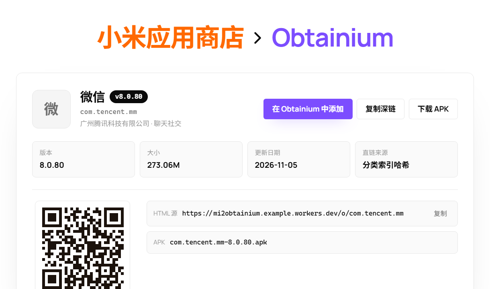
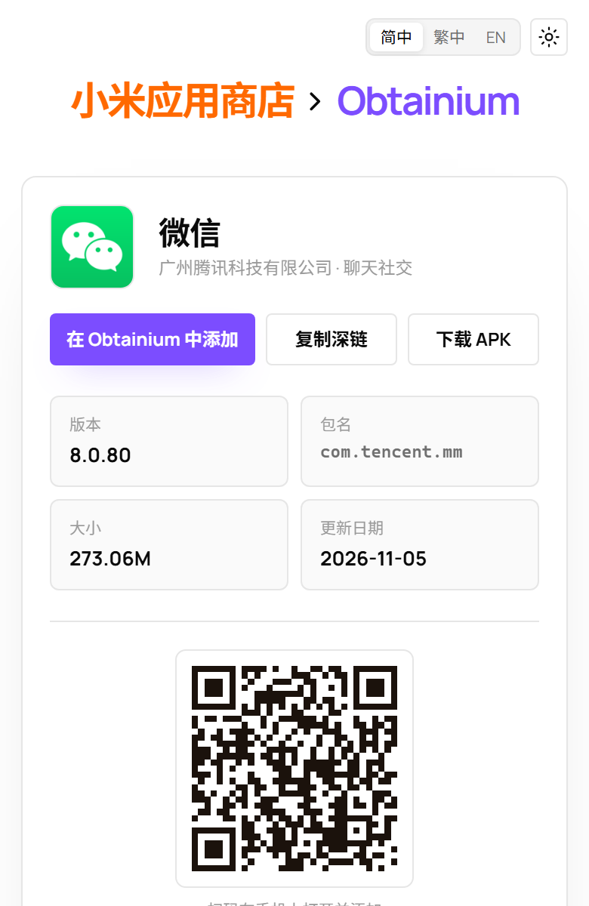

<h1 align="center">
  
  <br />
  mi2obtainium
</h1>

<p align="center">
  <strong>在网页上搜小米应用，点一下加进 Obtainium，之后自动检查更新</strong>
</p>

<p align="center">
  <a href="https://github.com/akanesamaa/mi2obtainium">GitHub</a>
  ·
  <a href="https://akanesamaa.github.io/mi2obtainium/">在线使用</a>
</p>

<p align="center">
  <a href="https://github.com/akanesamaa/mi2obtainium">
    
  </a>
  <a href="https://workers.cloudflare.com/">
    
  </a>
  <a href="https://pages.github.com/">
    
  </a>
</p>

<hr />

- 能搜约 2.7 万个小米应用，中文名、包名都能搜
- 打开结果页时，Cloudflare Worker 去小米商店现查版本和下载地址
- 能直接加进 Obtainium，也能手动填 HTML 源
- 支持简体中文 / 繁体中文 / 英文，浅色 / 深色
- Worker 默认缓存解析结果 15 分钟，命中后不再请求小米
- APK 由手机直接从小米下载服务器下载，不经过中转服务器

<p align="center">
  
</p>

<p align="center">
  
  
</p>

## 心路历程

我的手机刷了 [xiaomi.eu](https://xiaomi.eu/)，就算装了小米应用商店也没法通过它安装软件，但就是想用小米应用商店，就这样。后面找到 [Obtainium](https://github.com/ImranR98/Obtainium) 这个折中方案，发现 Obtainium 里面没有小米应用商店源，就有了这个项目

## 实现原理

简单说分三步：

1. 你在 Pages 首页搜应用
2. Worker 去小米商店现查版本和下载地址
3. Obtainium 拿着这个地址检查更新，手机直接从小米 CDN 下 APK

```text
你在网页搜索
        │
        ▼
Worker 去小米商店查
        │
        ▼
拿到 APK 下载地址
        │
        ▼
Obtainium 添加并检查更新
        │
        ▼
手机直接从小米 CDN 下载
```

小米网页版的普通应用下载按钮有人机验证，直接点 `/download/...` 会跳回详情页，Obtainium 拿到的是网页不是 APK

但小米的公开分类列表里有一个 `AppStore/<hash>` 地址，`hash` 可以理解成小米给这个 APK 的内部编号，把编号接到 CDN 后面：

```text
https://f5.market.xiaomi.com/download/AppStore/<hash>
```

就是一条能直接下 APK 的地址，再在末尾加上版本号：

```text
https://f5.market.xiaomi.com/download/AppStore/<hash>/<version>.apk
```

这样 Obtainium 就能从文件名里认出版本号，APK 本身还是同一个

名称、版本、大小和更新时间，则从小米详情页读

Worker 只负责查地址，不托管 APK 文件

### 目前做不到的

- 只能搜到小米公开分类列表里的应用，大约 2.7 万个，冷门应用可以直接粘包名或链接
- 有 `AppStore/<hash>` 的应用才能生成固定页面，只有临时签名链接的应用得让 Worker 每次现查
- 只处理页面给出的一个 APK
- 搜索页在 Pages，Worker 只负责查地址，不负责搜索

## 部署方法

### 1 部署 Worker

#### 方式 A：Cloudflare 控制台连接 Git

1. Workers & Pages → **Create** → **Worker** → **Connect to Git**
2. 选择仓库 `akanesamaa/mi2obtainium`，分支 `main`
3. 根目录留空
4. 构建命令留空
5. 部署命令填：

```bash
npx wrangler deploy
```

6. 点 Deploy

#### 方式 B：命令行

```bash
npx wrangler login
npx wrangler deploy
```

部署后得到：

```text
https://mi2obtainium.<你的子域>.workers.dev
```

先测：

```text
/health
/o/tv.danmaku.bili
```

### 2 部署 Pages

1. 把项目推到 GitHub
2. 编辑 `packages.json`，至少留一个包名
3. Settings → Pages → Source 选 **GitHub Actions**
4. Settings → Secrets and variables → Actions → Variables 新建：

```text
WORKER_URL = 你的 Worker 地址
```

不要带结尾 `/`

5. Actions → **Build Obtainium Pages** → Run workflow

构建完成后打开：

```text
https://<用户名>.github.io/<仓库名>/
```

### 3 回填 PAGES_BASE

拿到 Pages 地址后，改 `worker/index.js`：

```js
const PAGES_BASE = 'https://<用户名>.github.io/<仓库名>';
```

然后重新部署 Worker：

```bash
npx wrangler deploy
```

这样 Worker 结果页才能从 Pages 加载字体和 favicon

### 4 在 Obtainium 里使用

Pages 搜应用 → Worker 结果页 → 点 **在 Obtainium 中添加**

深链打不开就手动填：

```text
来源：HTML
URL：https://<Worker 地址>/o/<包名>
版本正则：([^/]+)\.apk
匹配组：$1
```

### 容易踩的坑

- `WORKER_URL` 结尾多了 `/`
- `packages.json` 是空的，Actions 直接失败
- 改了 Worker 地址但没更新 `WORKER_URL`
- 改了 Pages 地址但没更新 `PAGES_BASE`
- Cloudflare 的 Git 连接没有授权对应仓库
- 构建命令没有留空，导致 Worker 构建失败

## 常见问题

### 搜不到某个应用

搜索只覆盖小米公开分类列表，冷门或没上架的应用搜不到，直接粘包名或详情页链接

### Worker 说没有可用的下载地址

应用不在分类列表里，详情页也没给下载链接，先打开 `https://app.mi.com/details?id=<包名>` 看看是不是「维护中」

### 维护中或没收录的应用

有些应用详情页显示「维护中」，或者根本不在分类列表里，就会既搜不到也下不了

铁路 12306（`com.MobileTicket`）就是一个例子：截至 2026-11-15，它的详情页显示「维护中」，同时不在分类列表里

这不是搜索坏了，等小米恢复下载，或者改用官方渠道

### Obtainium 说没有版本或没有 APK

确认 HTML 源填的是 Worker 的 `/o/<包名>`，版本正则填 `([^/]+)\.apk`，匹配组填 `$1`

### 版本和 APK 对不上

小米的分类列表和详情页有时会不同步，刷新结果页重新查一次；还不行就等小米更新

## 鸣谢

- [Obtainium](https://github.com/ImranR98/Obtainium)
- [HyperOS3EULocalization](https://github.com/LSHFGJ/HyperOS3EULocalization)

## License

MIT

仅用于个人学习与备份用途

---

友情链接：[linux.do](https://linux.do)


